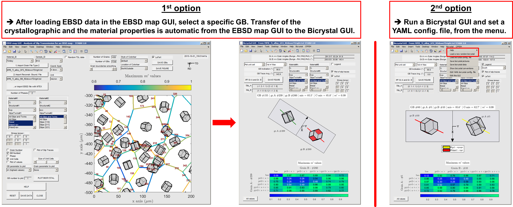
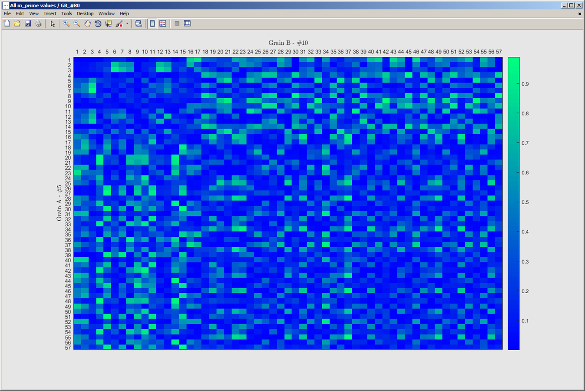

Bicrystal GUI
===============

.. include:: includes.rst

This GUI supports quantitative analysis of slip transmission across the grain boundary in a bicrystal.

The |matlab| function used to run the Bicrystal GUI is : `A_gui_plotGB_Bicrystal.m <https://github.com/stabix/stabix/tree/master/gui_bicrystal/A_gui_plotGB_Bicrystal.m>`_

This includes:

* :ref:`bicrystal_from_map`
* :ref:`all_mprime_values`

Loading Bicrystal data
--------------------------

It is possible to load bicrystal properties (material, phase, Euler angles of both grains, trace angle...) :
    - from the `EBSD map GUI <http://stabix.readthedocs.org/en/latest/ebsd_map_gui.html>`_ (by giving GB number and pressing the button 'PLOT BICRYSTAL') ;
    - from a `YAML config. bicrystal <https://github.com/stabix/stabix/tree/master/gui_bicrystal/gui_bicrystal_data/kacher_2012/Kacher2012_Fig.12.yaml>`_ (from the menu, by clicking on 'Bicrystal, and 'Load Bicrystal config. file').

   
   *The different steps to set the Bicrystal GUI.*

.. _bicrystal_from_map:

Plotting and analyzing a bicrystal
------------------------------------

.. figure:: ./_pictures/gui/BX.png
   :scale: 40 %
   :align: center
   
   *Screenshot of the Bicrystal GUI.*

The bicrystal legend shows the two selected slip-family entries only.
Slip traces and coordinate-triad lines do not add automatic ``data1``,
``data2``, etc. entries. Legend visibility, location, and LaTeX settings
remain controlled by the GUI options.

Tetragonal phases
-------------------

Select ``bct`` for the existing Sn/In examples or ``fct`` for the TiAl example.
The lattice parameters in ``listLattParam`` supply the material's c/a ratio.
Slip calculations and surface traces use the tetragonal lattice metric:
the Cartesian normal of (h k l) is proportional to [h, k, l/(c/a)],
whereas the Cartesian direction [u v w] is proportional to [u, v, w*(c/a)].
Vectors are normalized before calculating geometric slip-transfer parameters
and Schmid factors. The cubic limit is recovered when c/a = 1.

The TiAl elastic compliances are obtained by inverting the stiffness values
already documented in ``listElasticConstants`` (Zambaldi 2010). Tetragonal
Young's moduli use all six independent entries of that compliance matrix.

.. warning::
    BCT/FCT currently reuse the BCC/FCC slip and twin index tables.
    These are geometric candidates, not validated material-specific
    deformation modes. In particular, this does not add a complete
    gamma-TiAl ordinary/superdislocation/order-twinning model, nor a
    validated slip/twin catalogue for beta-Sn or In. Validate the selected
    systems and material constants against appropriate experimental data.
    Unit-cell drawings remain schematic; their displayed c/a ratio is not
    used in the numerical slip calculations. Unnormalized direction
    vectors use a = 1, not physical Burgers-vector lengths.

.. _all_mprime_values:

Distribution of all slip transmission parameters
--------------------------------------------------

You can open a new window to plot all values of the selected slip-transmission parameter for the selected slip families.

The minimum/maximum map in the Bicrystal GUI supports both single-phase and
two-phase materials (HCP, BCC/BCT and FCC/FCT). Each cell shows the selected
extremum over one pair of slip families, with grain A on the vertical axis
and grain B on the horizontal axis. Maps can be rectangular when the grains
have different numbers of slip families. As for single-phase maps, twin
systems are not included in this slip-family summary.

   
   *Screenshot of the distribution of all slip transmission parameters (e.g.: m' parameter for a single phase (HCP) bicrystal).*