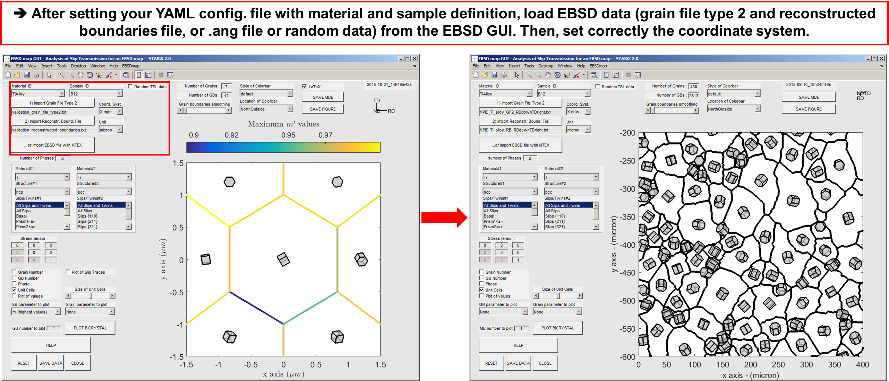
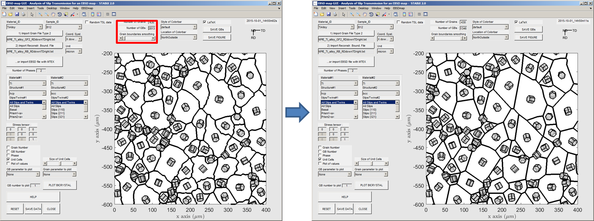
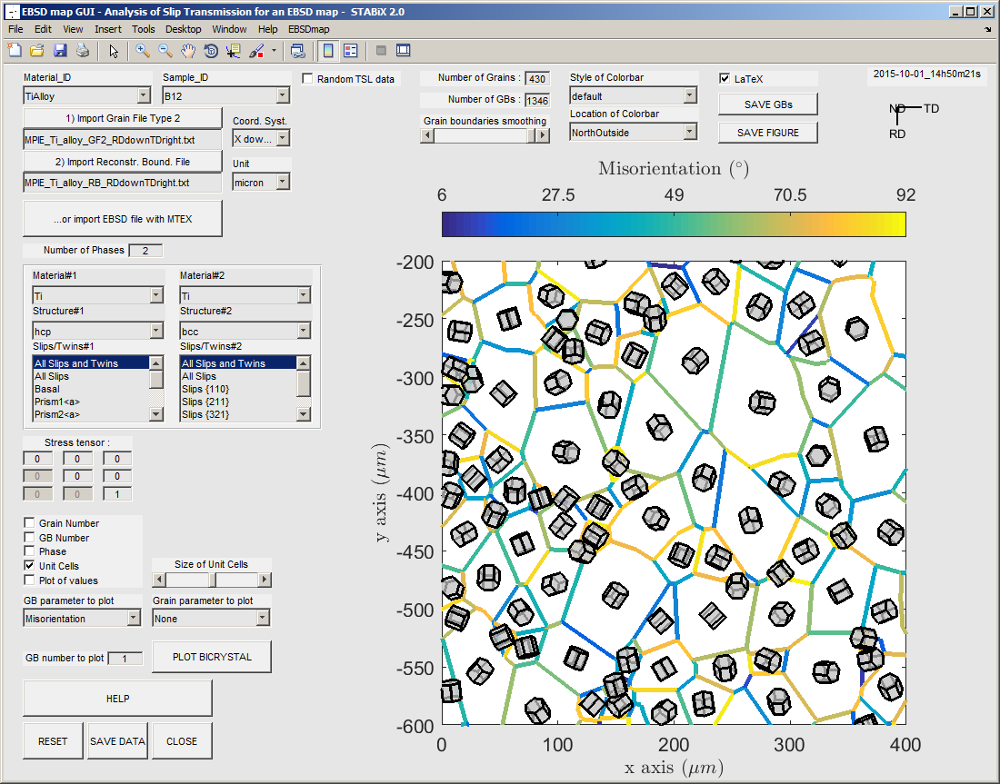
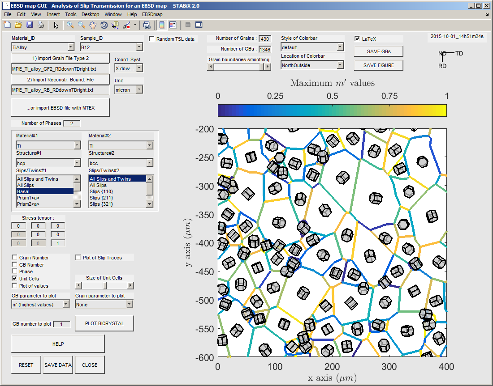
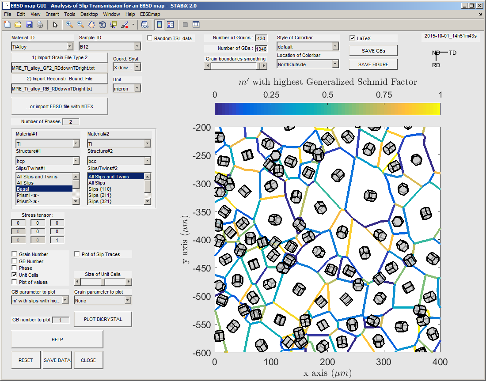
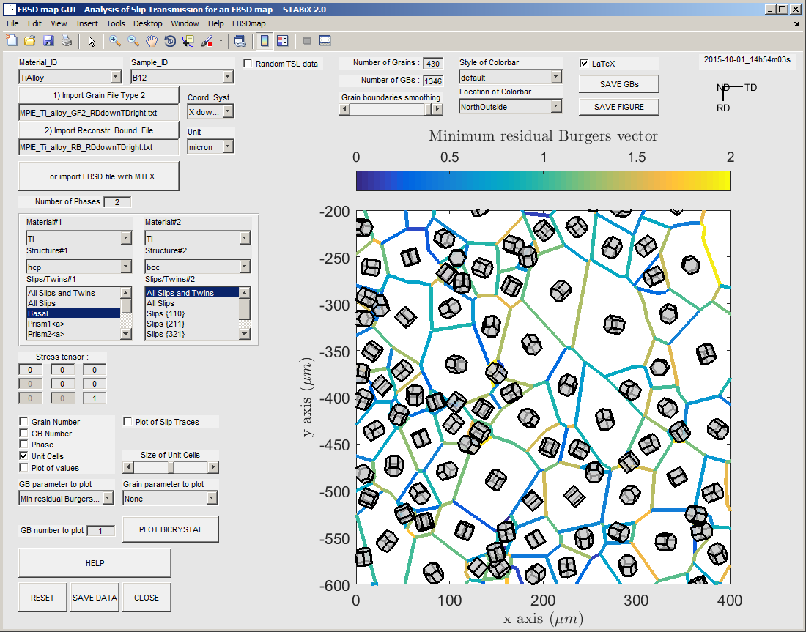
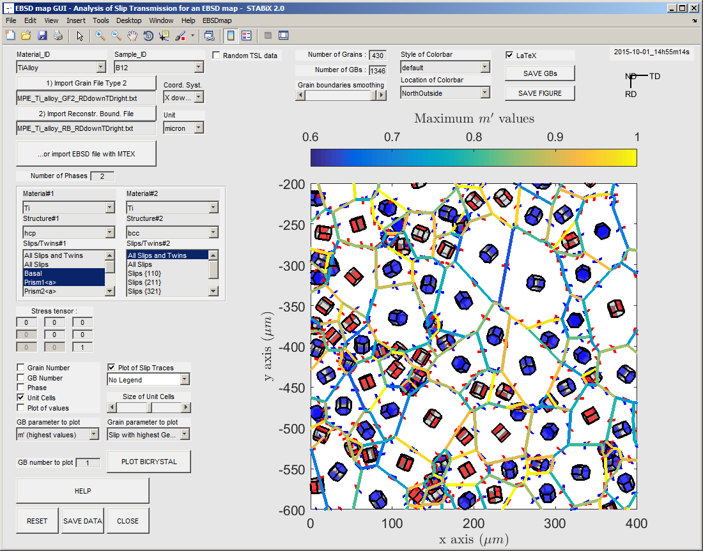
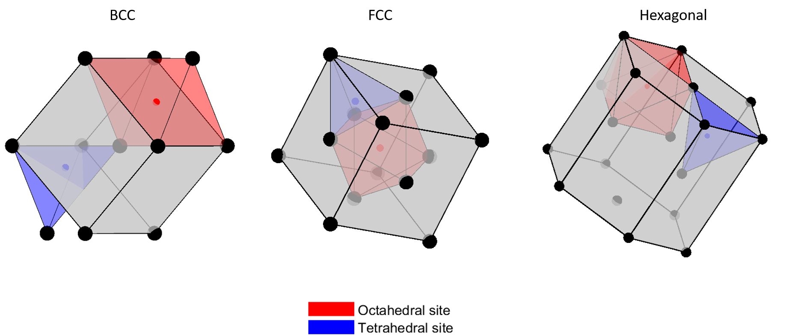

EBSD map GUI
============

.. include:: includes.rst
 
This GUI allows to analyze quantitatively slip transmission across grain boundaries for an EBSD map.

The |matlab| function used to run the EBSD map GUI is: `A_gui_plotmap.m <https://github.com/stabix/stabix/tree/master/gui_ebsd_map/A_gui_plotmap.m>`_

This includes:

* :ref:`loading_GBs`
* :ref:`smoothing_GBs`
* :ref:`misorientation_angle`
* :ref:`mp_parameter`
* :ref:`residual_Burgers_vector`
* :ref:`ebsd_chi_crack_ranking`
* :ref:`Schmid_factor_slip_traces`

.. _loading_GBs:

Loading EBSD data
---------------------------

For more details about the format of the EBSD data, see also the page:
`Experimental data <http://stabix.readthedocs.org/en/latest/experimental_data.html>`_.

   
   *The different steps for loading data into the EBSD map GUI.*
   
.. warning::
    Be careful when importing datasets with high number of grains (e.g. > 300 grains), the loading and plotting steps may take few minutes...

.. _smoothing_GBs:

Smoothing GBs segments
------------------------

The smoothing algorithm allows to decrease the total number of
grains boundaries in order to speed up calculations and plots.
Move the slicer in the right direction to decrease the total number of grains boundaries (i.e. segmentation reduction).

   
   *Screenshot of the EBSD map GUI with an EBSD map of near alpha phase
   Ti alloy a) before smoothing and b) after smoothing.*

The |matlab| function used to smooth GBs is:
`interface_map_GB_segments_opti.m <https://github.com/stabix/stabix/tree/master/gui_ebsd_map/interface_map_GB_segments_opti.m>`_

.. _misorientation_angle:

Misorientation angle
--------------------

   
   *Screenshot of the EBSD map GUI with an EBSD map of near alpha phase Ti alloy
   (GBs are color-coded according to the maximum misorientation angle).*

.. _mp_parameter:

m' parameter
------------

   
   *Screenshot of the EBSD map GUI with an EBSD map of near alpha phase Ti alloy
   (GBs are color-coded according to the maximum m' value).*

   
   *Screenshot of the EBSD map GUI with an EBSD map of near alpha phase Ti alloy
   (GBs are color-coded according to the maximum m' value for slip systems with the highest generalized Schmid factor).*

.. _residual_Burgers_vector:

Residual Burgers vector
-----------------------

   
   *Screenshot of the EBSD map GUI with an EBSD map of near alpha phase Ti alloy
   (GBs are color-coded according to the maximum residual Burgers vector magnitude).*

.. _ebsd_chi_crack_ranking:

Crack-path ranking with chi
---------------------------

Select **chi max (crack ranking; 90 deg GB)** at the end of the
**GB parameter to plot** menu. Each boundary is colored by the maximum
:math:`\chi` over all pairs of selected slip systems in its two grains,
on a fixed scale from 0 to 1. **Plot of Slip Traces** displays the first
maximizing pair when several pairs tie.

.. warning::
    A 2D EBSD map does not determine the grain-boundary plane inclination.
    This option uses the map's existing assumption that each boundary plane
    is perpendicular to the sample surface (90 degrees), with its normal
    derived from the boundary trace in the Euler-angle reference frame.
    Results are an approximation, not a reconstruction of the true 3D
    boundary geometry or a prediction of fracture.

Undefined intersections (a slip plane parallel to the boundary plane) and
padded slip-system entries are excluded. If no valid pair remains for a
boundary, the calculation raises ``STABiX:UndefinedChi``.

The maximum ranks geometric compatibility without specifying an observed
incoming crack/slip system. See :doc:`fatigue_crack` for the definition and
limitations of this crack-path ranking parameter. Fatigue indicator parameters
requiring cyclic plastic strain and stress are not computed from EBSD alone.

.. _Schmid_factor_slip_traces:

Schmid factor and slip trace analysis
-------------------------------------

   
   *Screenshot of the EBSD map GUI with an EBSD map of near alpha phase Ti alloy (slip plane plotted inside grain and 
   slip trace plotted around the unit cells; both are selected according to the maximum Schmid factor for a given stress tensor).*
   
Plot options
-------------------------------------

The |matlab| function used to plot the cell lattice is `vis_lattice.m <https://github.com/stabix/stabix/tree/master/crystallo/vis_lattice.m>`_.

It is also possible to plot the structure of octahedral and tetrahedral interstitial defects.

   
   *Octahedral (red) and tetrahedral (blue) interstitial symmetry polyhedra in a face-centered cubic, body centered cubic and hexagonal lattices.*
