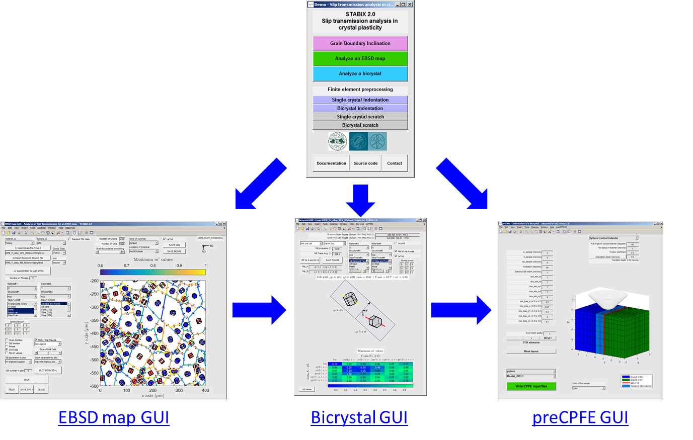

Getting started
===============

.. include:: includes.rst

Source Code
***************

.. include:: source_code.rst

README
********

For more details about using the toolbox, see the
`README <https://github.com/stabix/stabix/blob/master/README.rst>`_.
   
Path management
*****************

Run the following |matlab| function and answer ``y`` or ``yes`` to add the
toolbox folders to the |matlab| search path:

.. code-block:: matlab

   path_management

The |matlab| function used to set the |matlab| search paths is:
`path_management.m <https://github.com/stabix/stabix/tree/master/path_management.m>`_

The GUIs
**********

Run one of these graphical user interfaces (GUIs) to use the toolbox.

.. csv-table::
   :header: "|matlab| function", "Features", "YAML config. file"
   :widths: 25, 25, 25
  
   `demo <https://github.com/stabix/stabix/blob/master/demo.m>`_, "Start and run other GUIs.", ""
   `EBSD map GUI <https://github.com/stabix/stabix/blob/master/gui_ebsd_map/A_gui_plotmap.m>`_, "Analysis of slip transmission across GBs for an EBSD map.", `config_gui_EBSDmap_defaults.yaml <https://github.com/stabix/stabix/blob/master/yaml_config_files/config_gui_EBSDmap_defaults.yaml>`_
   `Bicrystal GUI <https://github.com/stabix/stabix/blob/master/gui_bicrystal/A_gui_plotGB_Bicrystal.m>`_, "Analysis of slip transfer in a bicrystal.", ""
   `preCPFE_SX <https://github.com/stabix/stabix/blob/master/gui_preCPFE/A_preCPFE_windows_indentation_setting_SX.m>`_, "Preprocessing of CPFE models for indentation or scratching in a single crystal.", `config_CPFEM_defaults.yaml <https://github.com/stabix/stabix/blob/master/yaml_config_files/config_CPFEM_defaults.yaml>`_
   `preCPFE_BX <https://github.com/stabix/stabix/blob/master/gui_preCPFE/A_preCPFE_windows_indentation_setting_BX.m>`_, "Preprocessing of CPFE models for indentation or scratching in a bicrystal.", `config_CPFEM_defaults.yaml <https://github.com/stabix/stabix/blob/master/yaml_config_files/config_CPFEM_defaults.yaml>`_
   `GBinc <https://github.com/stabix/stabix/blob/master/gui_gbinc/A_gui_gbinc.m>`_, "Calculation of grain-boundary inclination.", ""

   
   *The different GUIs of the STABiX toolbox.*
   
.. note::
    'SX' is used for single crystal and 'BX' for bicrystal.
   
Exporting a transparent figure
******************************

Each analysis GUI, but not the main launcher, has an **Export transparent PNG** toolbar
button (a blue arrow on a checkerboard). Click it to choose a filename and
folder; the suggested filename is ``export_fig_out.png`` in MATLAB's current
folder. The button exports the plots from its own GUI using ``export_fig``
with ``-transparent`` and ``-png``. It uses a temporary graphics-only copy,
excluding GUI controls and toolbars because recent MATLAB releases cannot
print UI components. The live GUI is not modified.
PNG is required to preserve transparency. Embedded images and explicitly
colored axes may retain their own backgrounds.

The existing **SAVE FIGURE** buttons and save-menu commands remain available
for ordinary exports. From the command window, transparent export is also
available with ``save_figure(pwd, gcf, '-transparent', '-png')``.

The YAML configuration files
*******************************

*"YAML is a human friendly data serialization standard for all programming languages."*

Default YAML configuration files, stored in the folder `yaml_config_files <https://github.com/stabix/stabix/tree/master/yaml_config_files>`_, are loaded automatically to configure the GUIs:

* `config.yaml <https://github.com/stabix/stabix/blob/master/yaml_config_files/config.yaml>`_
* `config_CPFEM_defaults.yaml <https://github.com/stabix/stabix/blob/master/yaml_config_files/config_CPFEM_defaults.yaml>`_
* `config_CPFEM_material_defaults.yaml <https://github.com/stabix/stabix/blob/master/yaml_config_files/config_CPFEM_material_defaults.yaml>`_
* `config_CPFEM_materialA_defaults.yaml <https://github.com/stabix/stabix/blob/master/yaml_config_files/config_CPFEM_materialA_defaults.yaml>`_
* `config_CPFEM_materialB_defaults.yaml <https://github.com/stabix/stabix/blob/master/yaml_config_files/config_CPFEM_materialB_defaults.yaml>`_
* `config_gui_EBSDmap_defaults.yaml <https://github.com/stabix/stabix/blob/master/yaml_config_files/config_gui_EBSDmap_defaults.yaml>`_
* `config_gui_BX_defaults.yaml <https://github.com/stabix/stabix/blob/master/yaml_config_files/config_gui_BX_defaults.yaml>`_
* `config_gui_SX_defaults.yaml <https://github.com/stabix/stabix/blob/master/yaml_config_files/config_gui_SX_defaults.yaml>`_
* `config_mesh_BX_defaults.yaml <https://github.com/stabix/stabix/blob/master/yaml_config_files/config_mesh_BX_defaults.yaml>`_
* `config_mesh_SX_defaults.yaml <https://github.com/stabix/stabix/blob/master/yaml_config_files/config_mesh_SX_defaults.yaml>`_
   
Create your own YAML configuration files by following the instructions in this `README <https://github.com/stabix/stabix/blob/master/yaml_config_files/README.txt>`_.

.. warning::
    If you create your own YAML configuration files after running STABiX,
    run the ``path_management`` |matlab| function again.

`Visit the YAML website for more information <http://www.yaml.org/>`_.

`Visit the archived YAML code for MATLAB <https://code.google.com/archive/p/yamlmatlab/>`_.

MTEX toolbox
****************

Some options and functions in STABiX require the `MTEX Toolbox <http://mtex-toolbox.github.io/>`_.

OpenGL
*********

On MATLAB releases before R2025a, if OpenGL rendering is unsatisfactory,
you can modify the ``matlab_opengl`` option in the `config.yaml <https://github.com/stabix/stabix/blob/master/yaml_config_files/config.yaml>`_ file.

MATLAB R2025a and newer no longer use OpenGL for graphics. STABiX ignores
``matlab_opengl`` on these releases and leaves renderer management to MATLAB.
The ``config.opengl`` field is an empty structure array because OpenGL
diagnostic data is unavailable.

On MATLAB R2025a and newer, the GUIs also retain MATLAB's default window
icon. The optional Java-based custom icon is skipped with a
``STABiX:CustomIconUnavailable`` warning because the ``JavaFrame`` property
has been removed. Older releases retain the existing custom icon behavior.

`Visit the MATLAB page about OpenGL rendering <https://www.mathworks.com/help/matlab/ref/opengl.html>`_.