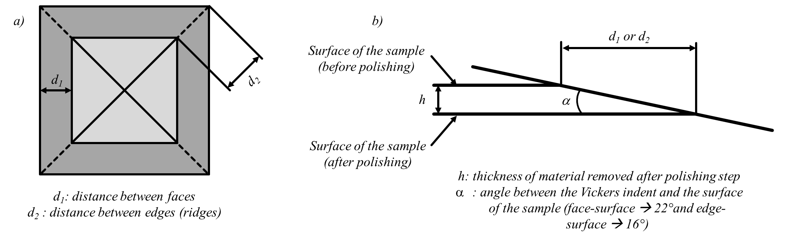

A MATLAB toolbox to analyze grain boundary inclination from SEM images
========================================================================

.. include:: includes.rst

.. include:: source_code.rst

This toolbox determines grain-boundary inclination from two micrographs acquired before and after serial polishing.
At least three markers, such as microindents, are needed to register the images.

Examples of `micrographs from serial polishing.
<https://github.com/stabix/stabix/tree/master/gui_gbinc/sem_pictures_serial_polishing>`_

To get started with this toolbox, clone the repository, start MATLAB, and change
to the repository's root folder. Add the toolbox folders to the MATLAB search
path by running ``path_management``.
Finally you can start the launcher by typing `demo <https://github.com/stabix/stabix/blob/master/demo.m>`_ or
`A_gui_gbinc <https://github.com/stabix/stabix/blob/master/gui_gbinc/A_gui_gbinc.m>`_ at the MATLAB command prompt.

How to use the toolbox?
--------------------------

1) Run the function `A_gui_gbinc.m <https://github.com/stabix/stabix/blob/master/gui_gbinc/A_gui_gbinc.m>`_.
2) Select your first image before serial polishing.
3) Calibrate the image to obtain the scale factor.
4) Detect the edges.
5) Repeat the same operation for the second image obtained after serial polishing.
6) Overlay the images:

   - If control points do not exist (as on the first run), a window appears so you can define them.

   - Define three control points per image.

   - Select a point on the figure on the left, then on the figure on the right,
     and repeat this operation twice.
  
   - Close the control-point selection window (Ctrl+W).

   - Control points are saved in a ``.mat`` file in the same folder as the first image loaded.

7) If the control points are unsatisfactory, delete them and repeat step 6 to set new control points and generate a new overlay.
8) Optionally, save the overlay as ``screenshot.png`` in the same folder as the first image loaded.
9) Measure the distance between the edges (Vickers faces) or ridges of a single Vickers indent (see :numref:`vickers_indent`).
10) Measure the distance between the grain-boundary edges.
11) The grain-boundary inclination is reported in degrees.

* Calculation of the thickness of material removed by polishing

    .. math:: h = \frac{d}{\tan(90 - \alpha)}
        :label: h_polished

Here, :math:`d` is the distance between the edges (Vickers faces) or ridges of a
single Vickers indent measured before and after polishing, and :math:`\alpha`
is the angle between the Vickers indent and the sample surface (see :numref:`vickers_indent`).

* Calculation of grain boundary inclination

    .. math:: GB_{inc} = \tan \left(\frac{d_{GB}}{h}\right)
        :label: gb_inclination
        
Here, :math:`d_{GB}` is the distance between grain-boundary traces measured
before and after polishing, and :math:`h` is the calculated thickness of
material removed by polishing.
        
.. only:: html

    .. figure:: ./_pictures/gui/gui_gb_inc.png.gif
       :scale: 100 %
       :align: center
       
       *Screenshots of the MATLAB GUI used to calculate grain-boundary inclination.*

.. only:: latex

    .. figure:: ./_pictures/gui/gui_gb_inc.png
       :scale: 100 %
       :align: center
       
       *Screenshot of the MATLAB GUI used to calculate grain-boundary inclination.*

   
   *Schematics of a) the top view of a Vickers indent (before and after polishing) and b) the cross-sectional view.*

.. note::
    Images should have the same scale factor.

.. note::
    Distances and grain boundary inclination values are obtained with the mean scale factor of the two images.

See also
---------

`V. Randle and Dingley D., "Measurement of boundary plane inclination in a scanning electron microscope.", Scripta Metall., 1989, 23, pp. 1565–1569. <https://doi.org/10.1016/0036-9748(89)90129-4>`_

`V. Randle, "A methodology for grain boundary plane assessment by single-section trace analysis.", Scripta Mater., 2001, 44, pp. 2789-2794. <https://doi.org/10.1016/S1359-6462(01)00975-7>`_

Links
------

- `MATLAB - Interactive Exploration with the Image Viewer App <http://fr.mathworks.com/help/images/interactive-exploration-with-the-image-tool.html>`_
- `MATLAB - Distance tool <https://www.mathworks.com/help/images/ref/imdistline.html>`_
- `MATLAB - Image conversions <http://fr.mathworks.com/help/images/image-type-conversions.html>`_
- `MATLAB - Image filtering <http://fr.mathworks.com/help/images/linear-filtering.html>`_
- `MATLAB - Control Point Selection Tool <https://www.mathworks.com/help/images/ref/cpselect.html>`_
- `MATLAB - Spatial transformation from control point pairs <https://www.mathworks.com/help/images/ref/cp2tform.html>`_
- `MATLAB - Edge detection <https://www.mathworks.com/help/images/ref/edge.html>`_

Authors
--------

Written by D. Mercier [1] and C. Zambaldi [1].

[1] Max-Planck-Institut für Eisenforschung, 40237 Düsseldorf, Germany

Acknowledgements
-----------------

Parts of this work were supported under the NSF/DFG Materials
World Network program (DFG ZA 523/3-1 and NSF-DMR-1108211).

Keywords
---------

MATLAB ; Graphical User Interface (GUI) ; Grain Boundaries ; Polycrystalline Metals ;
Grain Boundary Inclination ; Serial Polishing ; Scanning Electron Microscope (SEM).