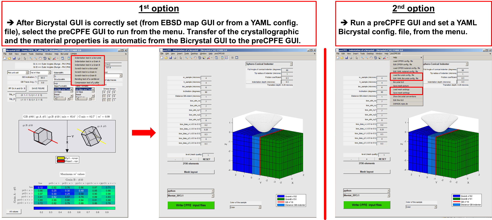
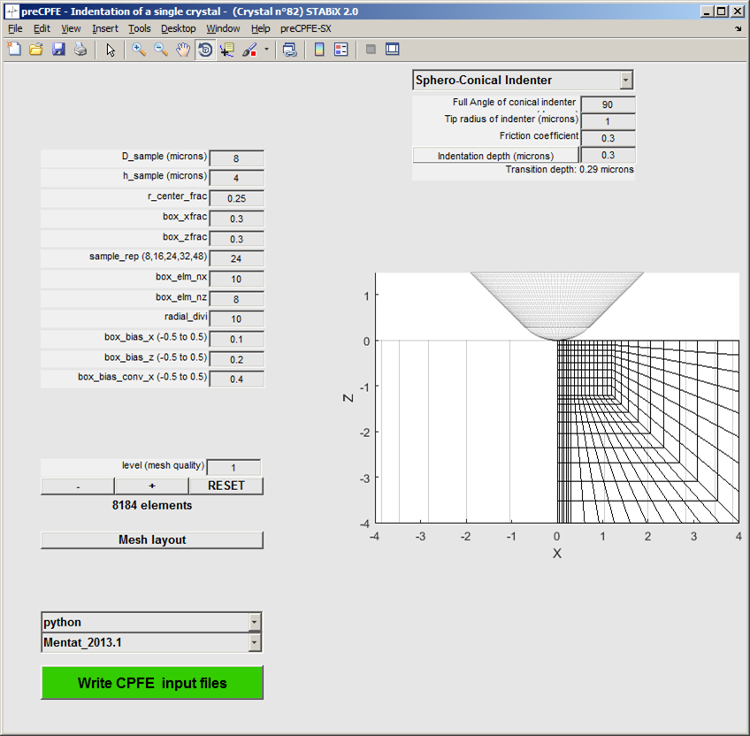
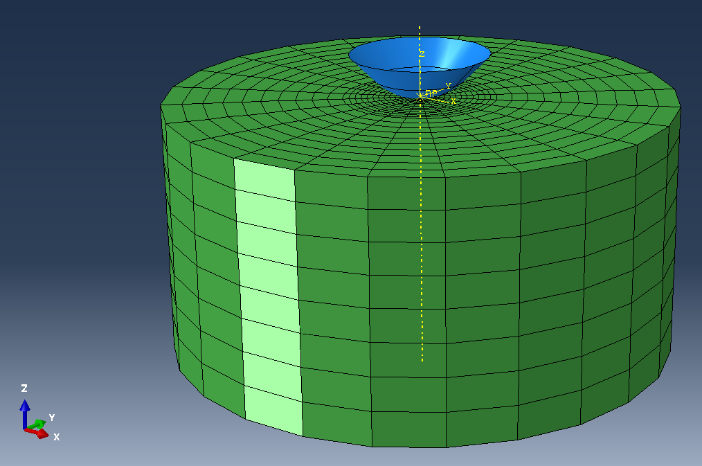
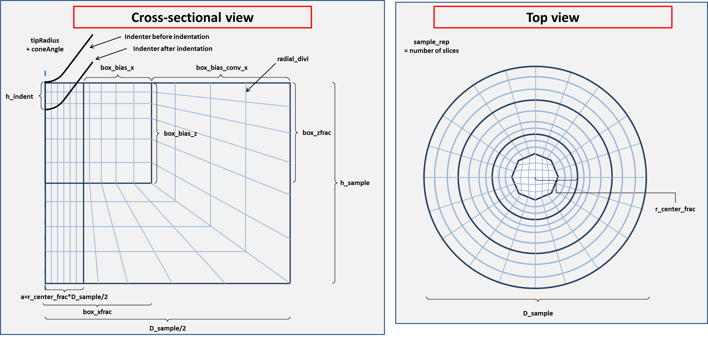
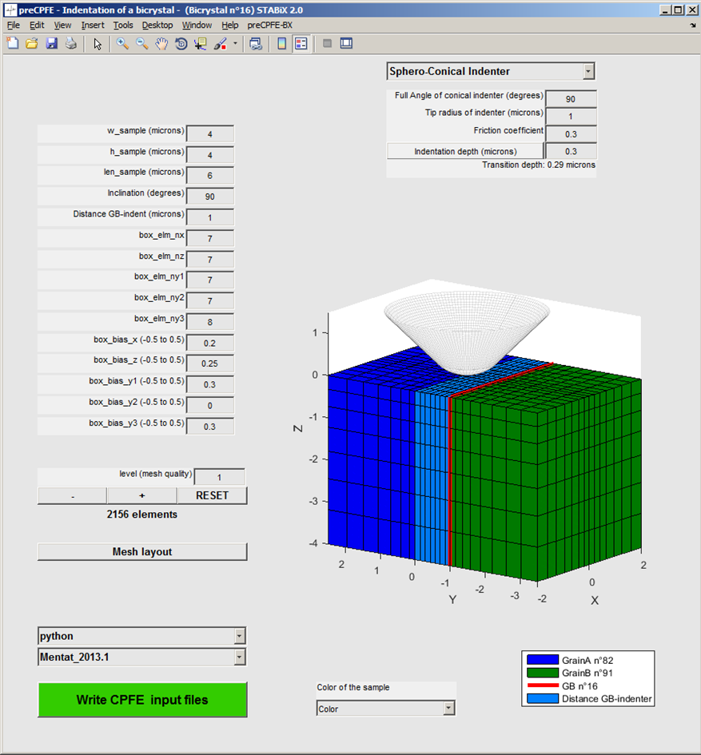
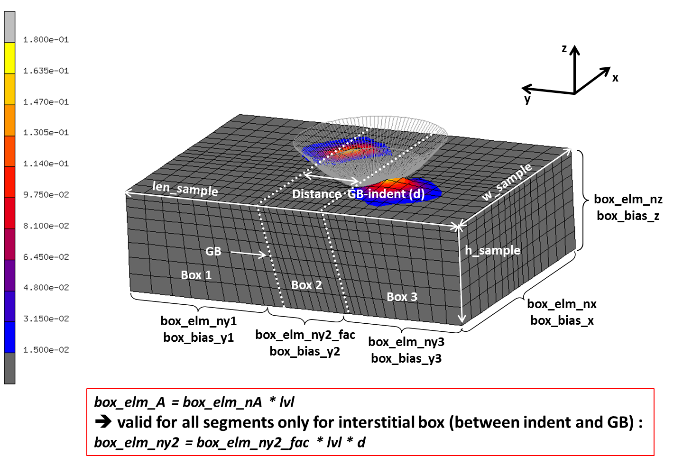
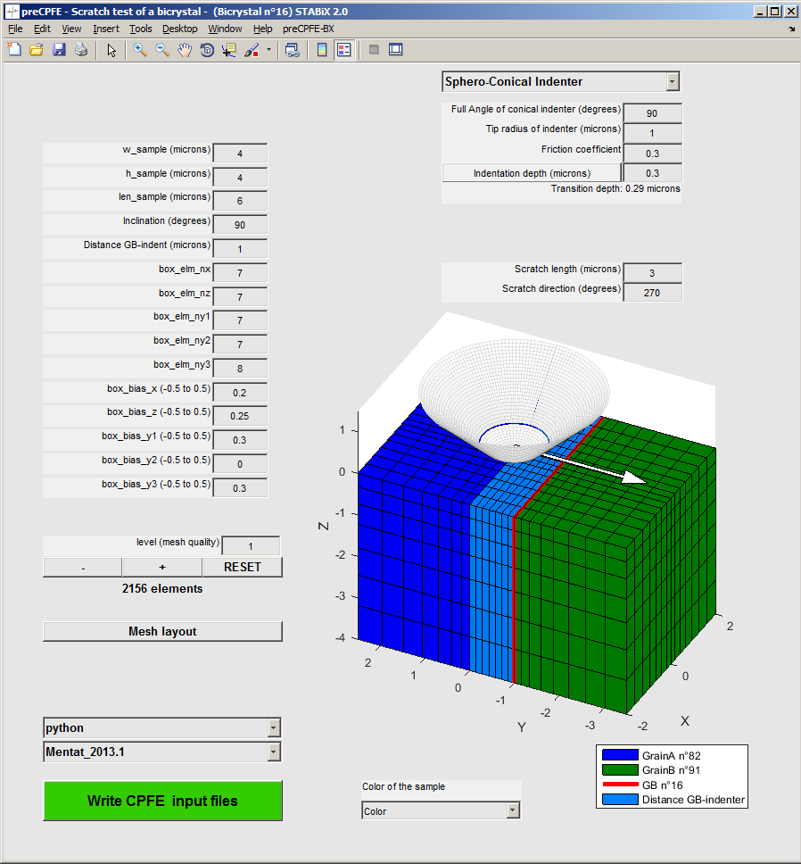
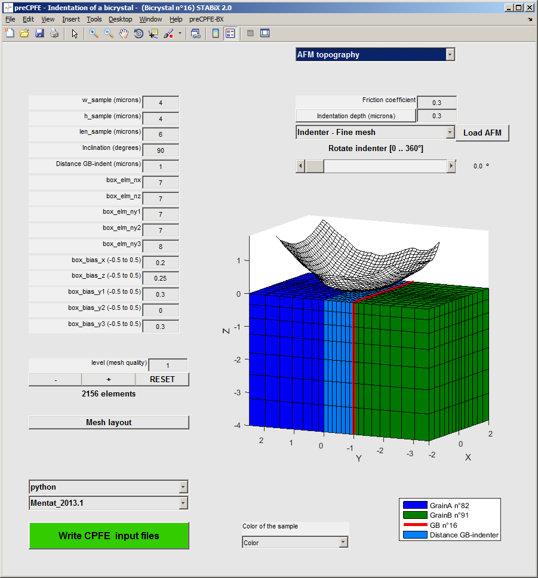

CPFE simulation preprocessing GUIs
===================================

.. include:: includes.rst

The *preCPFE* GUIs can rapidly transfer the experimental data into 
crystal plasticity finite element (CPFE) simulation input files. 
The types of input files are:

    * scripts to generate the finite element models in *MSC.Mentat* (2008 to 2014) (*procedure* file format) 
      or *Abaqus* (6.12 to 6.14) (Python script) based on the experimental data and test geometry;
    * the crystallographic orientations from the experimental data sets;
    * material parameter files for the subroutines that implement the constitutive model.

A parametrized visualization of the bicrystal indentation model through the GUI 
allows tuning the geometry and finite element discretization and the size of the 
sample and the indenter.

External Python is optional for opening these GUIs, previewing meshes, and
saving or loading YAML mesh settings. If no runnable external interpreter is
available (for example, in a MATLAB Online session without external Python),
STABiX issues a warning and disables **Write CPFE input files**. Selecting a
working interpreter with NumPy enables that button again. ANSYS script export
also requires external Python 3 and reports an error if it is unavailable.
The NumPy/SciPy checks are performed for the selected interpreter, not merely
to initialize the GUI.

Mesh previews use bundled MATLAB helpers, not an installed solver. Keep the
``marc_mentat`` and ``abaqus`` subfolders when copying ``gui_preCPFE`` to
MATLAB Drive. The mesh-bias dispatcher adds the needed helper folder to the
MATLAB path automatically. An incomplete copy raises
``STABiX:MissingMeshBiasHelper`` with the missing file's location.

Currently the following models can be written:

    * :ref:`single_crystal_indentation` (MSC.Mentat and Abaqus)
    * :ref:`bicrystal_indentation` (MSC.Mentat and Abaqus)
    * :ref:`scratch_test` (MSC.Mentat and Abaqus)
    
The `Python package used to generate the SX and BX indentation models
<https://github.com/stabix/stabix/tree/master/third_party_code/python>`_ is included in the repository.

Saving and loading mesh settings (YAML)
---------------------------------------

Use **Save mesh settings** and **Load mesh settings** in the preCPFE menu.
Saving reads the current edit boxes, rather than
cached preview variables, and excludes generated coordinates and mesh arrays.
New files use schema version 1 with separate sample, mesh and indenter groups.
For example, an SX configuration for Abaqus is:

.. code-block:: yaml

    schema_version: 1
    model: SX
    solver: Abaqus
    sample:
      D_sample: 8
      h_sample: 4
      r_center_frac: 0.25
      box_xfrac: 0.3
      box_zfrac: 0.3
    mesh:
      sample_rep: 24
      box_elm_nx: 10
      box_elm_nz: 8
      radial_divi: 10
      mesh_quality_lvl: 1
      box_bias_x: 3
      box_bias_z: 3
      box_bias_conv_x: 3
    indenter:
      coneAngle: 90
      tipRadius: 1
      h_indent: 0.3
      frictionCoeff: 0.3

BX files use ``model: BX``, their corresponding sample dimensions and mesh
subdivisions, and can include sample ``inclination`` and indenter
``scratchLength`` / ``scratchDirection``. Optional indenter settings can be
omitted from their mapping; absent optional settings retain their GUI values.
Indenter type, AFM topography, orientations and solver selection are not saved.
Select these separately before loading. Scratch settings require a scratch GUI.

Legacy flat mesh files, including the shipped defaults, remain readable.
Solver-suffixed legacy biases (``_abaqus`` / ``_mentat``) take precedence over
unsuffixed values for the active solver. Unsuffixed legacy values retain their
historical interpretation by that solver. New files record the solver explicitly
and reject a model or solver mismatch.

Missing fields, nonfinite or nonscalar numeric inputs and incompatible settings
are rejected before controls are changed. Existing GUI geometry checks still
apply on refresh. Cancelling either file dialog leaves the GUI unchanged.

For scripts, ``read_yaml_struct(filename)`` reads a nested YAML mapping and
``write_yaml_struct(filename, data)`` writes a scalar MATLAB structure using the
bundled YAMLMatlab backend. Missing files and write failures raise errors.
Writes are staged in the destination folder before replacing an existing file.
Empty mappings remain structures, including nested empty mappings.
``preCPFE_mesh_settings(data, interface, solver)`` converts either a legacy or
versioned document to the current schema (``interface`` is 1 for SX or 2 for BX).
With an active preCPFE figure, ``preCPFE_save_mesh([], filename)`` and
``preCPFE_load_mesh(interface, filename)`` skip the file dialogs.

.. note::
    Since 2022, DAMASK has no longer supported Abaqus. See
    https://damask-multiphysics.org/ for more information.

How to load crystallographic properties of an SX or BX model?
------------------------------------------------------------------

It is possible to set SX or BX properties (material, phase, Euler angles, trace angle...):

- from the `Bicrystal GUI <https://stabix.readthedocs.io/en/latest/bicrystal_gui.html>`_
  (by entering a GB number and pressing **PLOT BICRYSTAL**);

- from a YAML configuration file (from the menu, by clicking on 'preCPFE-SX' or
  'preCPFE-BX', and 'Load Single Crystal config. file' or 'Load Bicrystal config. file').

   
   *Steps for configuring the preCPFE GUIs.*

.. _single_crystal_indentation:

Single crystal (SX) indentation
--------------------------------

Analysis of the orientation-dependent pile-up topographies that are formed during
single crystal indentation provides insight into the operating deformation mechanisms.
CPFE simulation of single crystal indentation has an important role in clarifying
the influence of the single-slip behaviour of different slip systems on the resulting 
surface profiles.

The function used to run the preCPFE GUI for SX indentation is:
`A_preCPFE_windows_indentation_setting_SX.m
<https://github.com/stabix/stabix/tree/master/gui_preCPFE/A_preCPFE_windows_indentation_setting_SX.m>`_

   
   *Screenshot of the preCPFE GUI for single-crystal indentation.*
   

   
   *Screenshot of the single crystal indentation model in Abaqus.*

Convention for the single crystal mesh
***************************************

   
   *Convention used to define the single crystal mesh.*

.. _bicrystal_indentation:

Bicrystal (BX) indentation
---------------------------

CPFE simulation of indentation close to grain boundaries can provide a good approximation 
of the local micromechanics in this experiment.
While models that take into account the micromechanical effect of the boundary 
are the subject of ongoing research, most geometrical and kinematic factors are taken into account
by employing a local phenomenological crystal plasticity formulation in the simulations.

The function used to run the preCPFE GUI for BX indentation is:
`A_preCPFE_windows_indentation_setting_BX.m
<https://github.com/stabix/stabix/tree/master/gui_preCPFE/A_preCPFE_windows_indentation_setting_BX.m>`_

   
   *Screenshot of the preCPFE GUI for the bicrystal indentation.*

Convention for the bicrystal mesh
**********************************

   
   *Convention used to define the bicrystal mesh.*

.. _scratch_test:

Scratch test on SX and BX
--------------------------

CPFE simulation of scratch tests in a single crystal or close to a grain boundary is implemented in this GUI.
Scratch length and scratch direction have to be set by the user.

   
   *Screenshot of the preCPFE GUI for the scratch test.*

Indenter geometry
--------------------

Currently the following geometries can be used for CPFE simulations:
    * `cono-spherical indenter <https://github.com/stabix/stabix/blob/master/gui_preCPFE/preCPFE_3d_conospherical_indenter.m>`_;
    * `Berkovich indenter <https://github.com/stabix/stabix/blob/master/gui_preCPFE/preCPFE_3d_polygon_indenter.m>`_;
    * `Vickers indenter <https://github.com/stabix/stabix/blob/master/gui_preCPFE/preCPFE_3d_polygon_indenter.m>`_;
    * `cube-corner indenter <https://github.com/stabix/stabix/blob/master/gui_preCPFE/preCPFE_3d_polygon_indenter.m>`_;
    * `flat punch <https://github.com/stabix/stabix/blob/master/gui_preCPFE/preCPFE_3d_flat_punch_indenter.m>`_;
    * `free topography <https://github.com/stabix/stabix/blob/master/gui_preCPFE/preCPFE_3d_indenter_topo_AFM.m>`_ (from an AFM measurement for instance).
    
For the Berkovich, Vickers, cube corner indenters and the free topography,
the faces and vertices are saved in a structure variable from a patch object.
For the cono-spherical and the flat punch, geometries are already implemented
in the Python package for *MSC.Mentat* and *Abaqus*.
You can also call the |matlab| function `surf2patch
<https://www.mathworks.com/help/matlab/ref/surf2patch.html>`_ to return
the faces and vertices from a surface object.

Then the function `patch2inp <https://github.com/stabix/stabix/blob/master/util/patch2inp.m>`_
is used to generate an *Abaqus .inp* file, which is used
when the CPFE model is created in *MSC.Mentat* or *Abaqus*.

The Berkovich, Vickers and cube-corner tips can be rounded by setting the
pyramidal tip radius in the GUI, directly above the friction coefficient.
The default radius is 0.005 microns (5 nm) in both the single-crystal and
bicrystal GUIs. A radius of zero keeps the ideal sharp tip.
The rounded geometry is generated as a triangulated surface mesh and uses the
same export path as the sharp pyramidal indenters.

You can rotate the Berkovich, Vickers and cube-corner indenters and the free
topography directly in the GUIs before generating
of the *Abaqus .inp* file.

.. only:: html

    .. figure:: ./_pictures/gui/BX_Berko_rotate.gif
       :scale: 40 %
       :align: center
       
       *Screenshots of the preCPFE GUI for the bicrystal indentation with Berkovich indenter.*
   
.. only:: latex

    .. figure:: ./_pictures/gui/BX_Berko_rotate.png
       :scale: 40 %
       :align: center
       
       *Screenshot of the preCPFE GUI for the bicrystal indentation with Berkovich indenter.*
    
AFM topography
***************

The topography from an atomic force microscopy (AFM) measurement must be saved as a ``.txt`` file in *Gwyddion ASCII* format.

The |matlab| function used to load and read a Gwyddion file is:
`read_gwyddion_ascii.m <https://github.com/stabix/stabix/blob/master/gwyddion/read_gwyddion_ascii.m>`_

`Visit the Gwyddion website for more information. <http://gwyddion.net/>`_

   
   *Screenshot of the preCPFE GUI for the bicrystal indentation with loaded AFM topography of the indenter.*

Contact definition
-------------------

* *MSC.Mentat*
    - The indenter is modeled by a rigid body and the sample by a deformable body.
    - Contact is defined by a bilinear Coulomb friction model.

* *Abaqus*
    - The indenter is modeled by a rigid body and the sample by a deformable body.
    - The external surface of the indenter is defined as the "master" region.
    - The top surface of the (multilayer) sample is defined as the "slave" region.
    - If the friction coefficient is nonzero, the classical isotropic Coulomb friction model is used to define contact between the indenter and the sample.
    - If the friction coefficient is set to 0, contact is defined by frictionless tangential behavior and hard normal behavior.

A friction coefficient of 0.3 is set by default for every CPFE simulation.
You can modify this parameter by changing its value in the *preCPFE* GUIs.
    
Mesh definition
-------------------

* *MSC.Mentat*
    - The mesh uses hexahedral eight-node elements (hex8) by default.

* *Abaqus*
    - The mesh uses linear hexahedral eight-node elements (C3D8) by default.
    - To use quadratic elements (e.g., C3D20), change ``linear_elements`` from 1 to 0 in the Python code.

.. note::
    Consult the `DAMASK solver documentation <https://damask-multiphysics.org/documentation/usage.html#solver-features>`_
    for current solver capabilities. The Abaqus instructions below target legacy DAMASK interfaces.
    For detailed information about each element's characteristics, refer to the MSC.Marc and Abaqus user manuals.

Python setup
-------------

Generating solver-specific CPFE preprocessing scripts requires an external
Python interpreter with NumPy and SciPy versions compatible with the selected
backend. Some legacy Mentat/DAMASK generators require Python 2.x; keep their
solver-compatible environments separate from the modern standalone examples.
The historical NumPy 1.10.4 and SciPy 0.16.0 versions are not requirements for
the modern Python examples. See
`software_requirements.txt <https://github.com/stabix/stabix/blob/master/software_requirements.txt>`_
for workflow-specific requirements.
To let |stabix| find the interpreter, put it on the system's
`PATH <http://en.wikipedia.org/wiki/PATH_%28variable%29>`_ or enter its exact
location in the user configuration, as detailed below.

The Abaqus single-crystal model-script generator also accepts Python 3 when
material configuration generation is disabled. This does not update the legacy
material generator or the Mentat backend, which still require Python 2. The
generated model script must be run in a compatible Abaqus version.

Adjusting the configuration settings 
-------------------------------------

To write out the necessary files for finite element simulations it is likely that 
the user wants to adjust settings such as the Python installation or the
path where the files are written to. 
This can be done in the custom menu of the preCPFE GUIs: ``Edit CPFEM config file``.
A user-specific copy of the default configuration YAML file is created and
opened in the |matlab| editor. 
To benefit from later changes in the default settings, all
configuration parameters that are not specific to the user's setup should be deleted 
from the user's CPFE configuration file.

Installing DAMASK
------------------

Since 2022, DAMASK has no longer supported Abaqus. The Abaqus instructions
below apply to older DAMASK versions used with compatible finite element software.

For instructions on how to set up the DAMASK constitutive simulation code please visit
https://damask-multiphysics.org/documentation/index.html.

Writing the CPFE input files
-----------------------------

After everything is configured and the model geometry and discretization are optimized,
all necessary files to run a CPFE simulation can be generated by pressing the green button. 
All information will be written to a newly created folder which also includes a timestamp
for later reference.

Input files
------------

* *MSC.Mentat*
    - a procedure file containing the FEM model (\*.proc)
    - a Python file containing parameters for FEM model (\*.mat_FEM_model_parameters.py)
    - a Python file containing material configuration (\*.mat_DAMASK_materialconfig.py)
    - a MAT-file (binary |matlab| format file) storing |matlab| workspace variables (\*.mat)
    - a material configuration file (material.config)
    - an input file for a specific indenter geometry (\*.inp) (optional)

* *Abaqus*
    - a Python file containing the FEM model (\*.py)
    - a Python file containing parameters for FEM model (\*.mat_FEM_model_parameters.py)
    - a Python file containing material configuration (\*.mat_DAMASK_materialconfig.py)
    - a MAT-file (binary |matlab| format file) storing |matlab| workspace variables (\*.mat)
    - a material configuration file (material.config)
    - an input file for a specific indenter geometry (\*.inp) (optional)

* *ANSYS Mechanical*
    - an exported SpaceClaim/Discovery geometry script (\*.py) and its geometry-only output (\*.scdocx);
    - use the `Mechanical setup script
      <https://github.com/stabix/stabix/blob/master/gui_preCPFE/ansys/Mechanical/3D_SX_indentation_Mechanical_Materials-BCs-Mesh.py>`_
      in Mechanical to configure materials, contacts, boundary conditions and mesh.

ANSYS geometry export
*********************

In the SX or BX indentation GUI, select a Python 3 executable and choose
**Export ANSYS geometry script...** from the preCPFE menu. Run the resulting
Python script in a new, empty SpaceClaim/Discovery document with scripting API V251.
It saves an ``.scdocx`` geometry file beside the script and refuses to
overwrite an existing geometry file. The script does not reset the document.

The export supports a cono-spherical indenter and SX or BX indentation.
BX grain-boundary trace, inclination and signed distance are used; the
boundary must intersect both the top and bottom of the specimen. Scratch
tests, other indenter shapes and degenerate SX subdivisions are rejected.
The repository also includes an SX micropillar-compression geometry example,
but it is a separate Discovery script and is not generated by this GUI export.

This is **geometry only**: the GUI mesh preview and mesh settings are not
exported. Share topology between specimen bodies as appropriate, then
configure the mesh, contacts, loads, crystal-plasticity materials and grain
orientations manually in Mechanical. The generated geometry is not a
ready-to-solve CPFE model.

ANSYS Mechanical setup
**********************

Open the generated geometry in Mechanical, then run the example
`Materials-BCs-Mesh script
<https://github.com/stabix/stabix/blob/master/gui_preCPFE/ansys/Mechanical/3D_SX_indentation_Mechanical_Materials-BCs-Mesh.py>`_
from Mechanical's scripting editor. It demonstrates a basic setup for SX
cono-spherical indentation: assigning materials to the specimen and indenter,
creating automatic connections with frictionless contact, adding a fixed
support and a remote displacement (``Z = -1e-6 m``), and applying an automatic
**MultiZone** mesh using the **Medial Axis** decomposition method. It also adds
total-deformation and equivalent-stress results.

The script uses recorded body, geometry and object IDs, so check and update
its selections if the imported geometry or Mechanical model tree differs.
It is an example setup, not a general-purpose solver input generator. The
ANSYS geometry examples in this repository cover only cono-spherical SX/BX
indentation and SX micropillar compression; other indenter shapes and
geometries are not supported by these examples. The micropillar geometry is
available as a separate
`Discovery script
<https://github.com/stabix/stabix/blob/master/gui_preCPFE/ansys/3D_SX_micropillarCompression_Discovery_Geometry.py>`_.

Using the CPFE input files
-----------------------------

* *MSC.Mentat 'classic interface'*
    - 'Files' ==> 'Current Directory' ==> Select the folder containing input files
    - 'Utils' ==> 'Procedures' ==> Select procedure file containing the FEM model (\*.proc)

* *MSC.Mentat 'new interface (> 2012)'*
    - 'Files' ==> 'Current Directory' ==> Select the folder containing input files
    - 'Tools' ==> 'Procedures' ==> Select procedure file containing the FEM model (\*.proc)

* *Abaqus*
    - 'File' ==> 'Set Work Directory...' ==> Select the folder containing input files
    - 'File' ==> 'Run Script' ==> Select the Python file containing the FEM model (\*.py)
    
Running a job with DAMASK
---------------------------

Find the full DAMASK documentation here: https://damask-multiphysics.org/documentation/index.html.

* *MSC.Mentat*
    - In the JOB RUN menu choose USER SUBROUTINE FILE and select the interface routine DAMASK_marc.f90.

* *Abaqus*
    - In the Job Manager > Create... specify the User subroutine file (either DAMASK_abaqus_std.f or DAMASK_abaqus_exp.f).

.. note::
    For Abaqus, you may have to modify the extension of the subroutine:
        - .f if the operating environment is Linux;
        - .for if the operating environment is Windows.

See also
----------

`Wang Y. et al., "Orientation dependence of nanoindentation pile-up patterns and of nanoindentation microtextures in copper single crystals", Acta Materialia (2004). <https://doi.org/10.1016/j.actamat.2004.01.016>`_

`Liu Y. et al., "Combined numerical simulation and nanoindentation for determining mechanical properties of single crystal copper at mesoscale", Journal of the Mechanics and Physics of Solids (2005). <https://doi.org/10.1016/j.jmps.2005.07.003>`_

`Zaafarani N. et al., "Three-dimensional investigation of the texture and microstructure below a nanoindent in a Cu single crystal using 3D EBSD and crystal plasticity finite element simulations", Acta Materialia (2006). <https://doi.org/10.1016/j.actamat.2005.12.014>`_

`Zambaldi C. et al., "Modeling and experiments on the indentation deformation and recrystallization of a single-crystal nickel-base superalloy", Materials Science and Engineering A (2007). <https://doi.org/10.1016/j.msea.2006.11.068>`_

`Liu Y. et al., "Orientation effects in nanoindentation of single crystal copper", International Journal of Plasticity (2008). <https://doi.org/10.1016/j.ijplas.2008.02.009>`_

`Zaafarani N. et al., "On the origin of deformation-induced rotation patterns below nanoindents", Acta Materialia (2008). <https://doi.org/10.1016/j.actamat.2007.09.001>`_

`Casals O. and Forest S., "Finite element crystal plasticity analysis of spherical indentation in bulk single crystals and coatings", Computational Materials Science (2009). <https://doi.org/10.1016/j.commatsci.2008.09.030>`_

`Gerday A. F. et al., "Interests and limitations of nanoindentation for bulk multiphase material identification: Application to the β phase of Ti-5553", Acta Materialia (2009). <https://doi.org/10.1016/j.actamat.2009.07.020>`_ 

`Britton T.B. et al., "The effect of crystal orientation on the indentation response of commercially pure titanium: experiments and simulations", Proc. R. Soc. A (2010). <https://doi.org/10.1098/rspa.2009.0455>`_

`Chang H.-J. et al., "Multiscale modelling of indentation in FCC metals: From atomic to continuum", C. R. Physique (2010). <https://doi.org/10.1016/j.crhy.2010.07.007>`_

`Zambaldi C. and Raabe D., "Crystal plasticity modelling and experiments for deriving microstructure-property relationships in γ-TiAl based alloys", Journal of Physics (2010). <https://doi.org/10.1088/1742-6596/240/1/012140>`_

`Zambaldi C., "Micromechanical modeling of γ-TiAl based alloys", PhD Thesis (2010). <https://doi.org/10.2370/9783832297176>`_

`Zambaldi C. and Raabe D., "Plastic anisotropy of c-TiAl revealed by axisymmetric indentation", Acta Materialia (2011). <https://doi.org/10.1016/j.actamat.2010.02.025>`_

`Vu-Hoang S. et al., "Crystal Plasticity of Single Crystal and Film on Substrate Probed by Nano-lndentation: Simulations and Experiments", Mater. Res. Soc. Symp. Proc. (2011). <https://doi.org/10.1557/opl.2011.1510>`_

`Eidel B., "Crystal plasticity finite-element analysis versus experimental results of pyramidal indentation into (001) fcc single crystal", Acta Materialia (2011). <https://doi.org/10.1016/j.actamat.2010.11.042>`_

`Zambaldi C. et al., "Orientation informed nanoindentation of a-titanium: Indentation pileup in hexagonal metals deforming by prismatic slip", J. Mater. Res. (2012). <https://doi.org/10.1557/jmr.2011.334>`_

`Zahedi A. et al., "Indentation in f.c.c. single crystals", Solid State Phenomena (2012). <https://doi.org/10.4028/www.scientific.net/SSP.188.219>`_

`Liu M. et al., "Crystal Plasticity Study of the Effect of the Initial Orientation on the Indentation Surface Profile Patterns and Micro-Textures of Aluminum Single Crystal", Advances in Materials and Processing Technologies (2013). <https://doi.org/10.1002/srin.201300011>`_

`Han F. et al., "Experiments and crystal plasticity finite element simulations of nanoindentation on Ti-6Al-4 V alloy", Materials Science & Engineering A (2014). <https://doi.org/10.1016/j.msea.2014.11.090>`_

`Choudhury S.F. et al., "Single Crystal Plasticity Finite Element Analysis of Cu6Sn5 Intermetallic", Metall. and Mat. Trans. A (2014). <https://doi.org/10.1007/s11661-014-2696-0>`_

`González D. et al., "Numerical analysis of the indentation size effect using a strain gradient crystal plasticity model", Computational Materials Science (2014). <https://doi.org/10.1016/j.commatsci.2013.10.004>`_

`Esqué-de los Ojos D. et al., "Sharp indentation crystal plasticity finite element simulations: Assessment of crystallographic anisotropy effects on the mechanical response of thin fcc single crystalline films", Computational Materials Science (2014). <https://doi.org/10.1016/j.commatsci.2014.01.064>`_

`Kitahara H. et al., "Anisotropic deformation induced by spherical indentation of pure Mg single crystals", Acta Materialia (2014). <https://doi.org/10.1016/j.actamat.2014.06.039>`_

`Kucharski S. et al., "Surface Pile-Up Patterns in Indentation Testing of Cu Single Crystals", Experimental Mechanics (2014). <https://doi.org/10.1007/s11340-014-9883-1>`_

`Liu M. et al., "A crystal plasticity study of the effect of friction on the evolution of texture and mechanical behaviour in the nano-indentation of an aluminium single crystal", Computational Materials Science (2014). <https://doi.org/10.1016/j.commatsci.2013.05.030>`_

`Yao W.Z. et al., "Plastic material parameters and plastic anisotropy of tungsten single crystal: a spherical micro-indentation study", J. Mater. Sci. (2014). <https://doi.org/10.1007/s10853-014-8080-z>`_

`Charleux L., "Abapy Documentation". <http://abapy.readthedocs.org/en/latest/index.html>`_

`Zambaldi C. et al., "Orientation dependent deformation by slip and twinning in magnesium during single crystal indentation", Acta Materialia (2015). <https://doi.org/10.1016/j.actamat.2015.01.046>`_

`Sánchez-Martín R. et al., "High temperature deformation mechanisms in pure magnesium studied by nanoindentation", Scripta Materialia (2015). <https://doi.org/10.1016/j.scriptamat.2015.03.012>`_

`Mao L. et al., "Explore the anisotropic indentation pile-up patterns of single-crystal coppers by crystal plasticity finite element modelling", Materials Letters (2015). <https://doi.org/10.1016/j.matlet.2015.08.093>`_

`Mao L. et al., "Crystal plasticity FEM study of nanoindentation behaviors
of Cu bicrystals and Cu–Al bicrystals", J. Mater. Res., (2015). <https://doi.org/10.1557/jmr.2015.223>`_

`Renner E. et al., "Sensitivity of the residual topography to single crystal plasticity parameters in Berkovich nanoindentation on FCC nickel", International Journal of Plasticity, (2015). <https://doi.org/10.1016/j.ijplas.2015.10.002>`_

`Juran P. et al., "Investigation of indentation-, impact- and scratch-induced mechanically affected zones in a copper single crystal", Comptes Rendus Mécanique, (2015). <https://doi.org/10.1016/j.crme.2015.03.003>`_

`Materna A. et al., "A Numerical Investigation of the Effect of Cubic Crystals Orientation on the Indentation Modulus", Acta Physica Polonica A, (2015). <https://doi.org/10.12693/APhysPolA.128.693>`_

`Csanádi T. et al., "Nanoindentation induced deformation anisotropy in β-Si3N4 ceramic crystals", Journal of the European Ceramic Society, (2015). <https://doi.org/10.1016/j.jeurceramsoc.2015.11.028>`_

`Liu M. et al., "A combined experimental-numerical approach for determining mechanical properties of aluminum subjects to nanoindentation", Scientific Reports, (2015). <https://doi.org/10.1038/srep15072>`_

`Su Y. et al., "Quantifying deformation processes near grain boundaries in α titanium using nanoindentation and crystal plasticity modeling", International Journal of Plasticity, (2016). <https://doi.org/10.1016/j.ijplas.2016.08.007>`_

`Weaver J.S. et al., "On capturing the grain-scale elastic and plastic anisotropy of alpha-Ti with spherical nanoindentation and electron back-scattered diffraction", Acta Materialia, (2016). <https://doi.org/10.1016/j.actamat.2016.06.053>`_

`Han F. et al., "Indentation Pileup Behavior of Ti-6Al-4V Alloy: Experiments and Nonlocal Crystal Plasticity Finite Element Simulations", Metallurgical and Materials Transactions A, (2017). <https://doi.org/10.1007/s11661-016-3946-0>`_

`Chakraborty A. and Eisenlohr P., "Evaluation of an inverse methodology for estimating constitutive parameters in face-centered cubic materials from single crystal indentations", European Journal of Mechanics - A/Solids, (2017). <https://doi.org/10.1016/j.euromechsol.2017.06.012>`_

Zhao Z. et al., "Temperature dependent constitutive parameters from nanoindentation", poster for Chems Forum 2019, MSU.

`Wang Q. et al., "Orientation-dependent irradiation hardening in pure Zr studied by nanoindentation, electron microscopies, and crystal plasticity finite element modeling", International Journal of Plasticity, (2019). <https://doi.org/10.1016/j.ijplas.2019.08.007>`_

`Das S. et al., "Orientation-dependent indentation response of helium-implanted tungsten", Appl. Phys. Lett., (2019). <https://doi.org/10.1063/1.5097403>`_

`Zhou Y. et al., "Experimental study and crystal plasticity finite element simulations of nano-indentation-induced lattice rotation and the underlying mechanism in TC6 single α-grain", Materials and Design, (2019). <https://doi.org/10.1016/j.matdes.2019.108423>`_

`Terentyev D. et al., "High temperature nanoindentation of tungsten: Modelling and experimental validation", International
Journal of Refractory Metals and Hard Materials, (2020). <https://doi.org/10.1016/j.ijrmhm.2020.105222>`_

`Li Y. et al., "Crystal plasticity assessment of the effect of material parameters on contact depth during spherical indentation", International
S.I. : Computational Mechanics of Materials, (2020). <https://doi.org/10.1007/s00161-020-00901-4>`_
