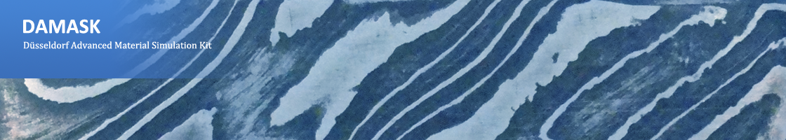

References
==============

Related Projects
##################

   
   `MTEX <http://mtex-toolbox.github.io/>`_

   
   `DAMASK <https://damask-multiphysics.org/>`_

Institutions
##################

   
   `Max-Planck-Institut fuer Eisenforschung GmbH (Duesseldorf, Germany) <http://www.mpie.de/>`_

   
   `Department of Chemical Engineering and Materials Science / Michigan State University (East Lansing, MI, USA) <https://www.msu.edu/>`_

   
   `IMDEA Materials Institute (Madrid, Spain) <https://materials.imdea.org/>`_

   
   `Structural Integrity, Institute of Materials Engineering Australian Nuclear Science and Technology Organisation (Australia) <http://www.ansto.gov.au/>`_

   
   `Physikalische Metallkunde TU Darmstadt (Darmstadt, Germany) <http://www.tu-darmstadt.de/>`_

   
   `RWTH Aachen University (Aachen, Germany) <http://www.rwth-aachen.de/>`_
   

   
   `Arizona State University, Solanki Research Group (Tempe, USA) <https://multiphysics.lab.asu.edu/>`_
   

   
   `Queen's University, NSERC Research Chair in Nuclear Materials (Kingston, Canada) <https://smithengineering.queensu.ca/mme/research/nuclear-materials.html>`_
   

   
   `National University of Ireland (Galway, Ireland) <http://www.nuigalway.ie/>`_
   

   
   `USC Viterbi School of Engineering (Los Angeles, USA) <https://viterbischool.usc.edu/>`_
   

   
   `Los Alamos National Laboratory (Los Alamos, USA) <https://www.lanl.gov/>`_
