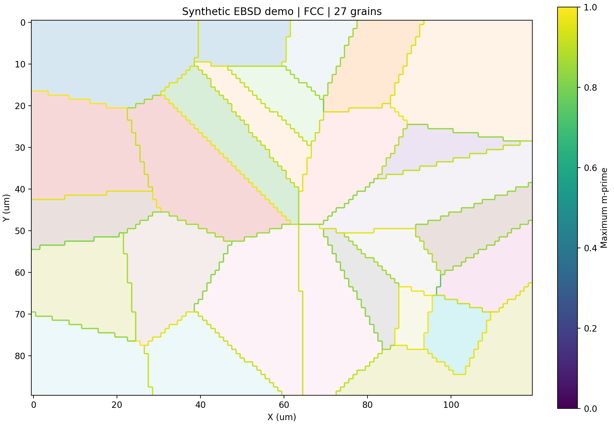
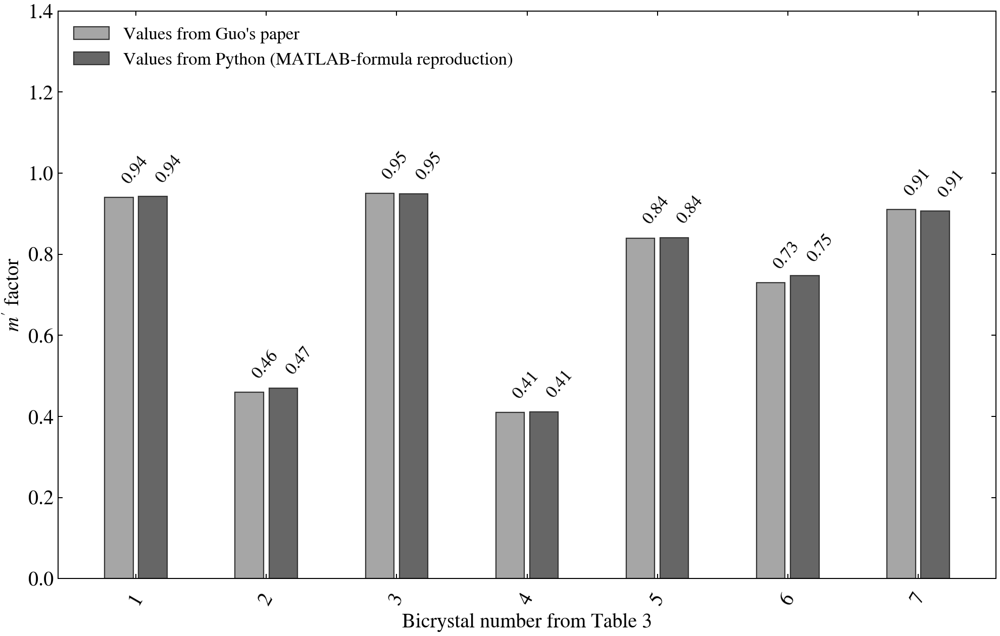

# Python EBSD Boundary Map

Standalone NumPy/SciPy/Matplotlib example, with PyYAML for literature cases.
No MATLAB or MTEX installation is needed.
Requires Python 3.10 or later. Run the commands below from the repository root.

## Interactive Notebook

Open [ebsd_mprime_example.ipynb](ebsd_mprime_example.ipynb) in VS Code or Jupyter
and run the cells in order. It loads these files from
`gui_ebsd_map/ebsd_dataExamples`:

- `MPIE_Ti_alloy_GF2_RDdownTDright.txt`: grain-average orientations and phases.
- `MPIE_Ti_alloy_RB_RDdownTDright.txt`: exact reconstructed boundary segments.

The notebook plots maximum m-prime, N-factor and residual Burgers-vector
boundary maps, its distribution, and the lowest-compatibility grain pairs,
and includes literature cross-checks. Residuals are only computed for
alpha-alpha pairs, using an illustrative Burgers magnitude of 0.298 nm.
Select a Python kernel with the dependencies below installed;
the requirements include `ipykernel` for VS Code.

## Experimental Descriptor Notebook

Open [experimental_descriptors.ipynb](experimental_descriptors.ipynb) for the
implementation companion to the supplied experimental Ti-alloy manuscript.
It is separate from the m-prime notebook and reuses the actual GF2/RB sources.

- Real alpha-grain matrices, quaternions, stereographic IPF coordinates,
  six HCP slip-family orientation factors, and geometrical competition indices.
- Explicit CRSS-ratio sensitivity, plus m-prime, signed N matrices, residual
  Burgers-vector geometry, and symmetry-aware same-phase disorientation.
- Synthetic unloading fits and hardness, plus a measured Granta MI AFM scan
  for exploratory circular-ROI leveling, pile-up, and angular morphology.
- Synthetic-only association/bootstrap/axial statistics and ordinal evidence
  classification, with grain-held-out validation rather than activation laws.
- Real-data CSV exports and a JSON provenance sidecar with source hashes,
  method/software versions, conventions, units, parameters, and validity.

Reusable calculations live in
[experimental_descriptors.py](experimental_descriptors.py). Install the shared
requirements (including pandas and statsmodels) in the notebook kernel.
Running all cells writes regenerable tables to `descriptor_exports/`.
The experimental notebook also plots signed N-factor and residual
Burgers-vector metrics on the same boundary-only map; undefined interphase
residuals are left uncolored.

The repository does not contain the manuscript's matched indentation curves,
complete AFM cohort, registration transforms, or evidence labels. Synthetic results
are explicitly labeled and never exported as experimental measurements or
paper coefficients. The 429 alpha grains in the GF2 export are not the
manuscript's selected 36-orientation/23-complete-record cohort. Granta MI is an
optional, disabled-by-default integration described below. No constitutive fit
or direct slip-activation claim is made.

Safeguards include undefined competition indices at zero total factor,
stress-unit-invariant CRSS regularization, missing-pixel propagation, circular
line-angle differences, no trace assignment without registration, no boundary
inclination from a 2D trace, and no independence-based p-value for clustered
records. The notebook lists all real-data inputs needed to replace the demos.

The AFM example uses the `Height` channel in `mercier_tialloy_b18.000`,
extracted from the MI record `Ti5AlSn2.5Sn_AFM_2014-03-05` and linked to
grain 176 / test B18. Its source file is kept locally in the ignored
`python/mi_afm_data/` directory, not committed. If needed, extract it from
the record's `2014-03-05_AFM.7z` archive into that directory, or set
`GRANTA_AFM_FILE` to the extracted file. The notebook requires the dependencies
in `requirements.txt`, including Gwyddion's Nanoscope reader. The automatically
selected minimum-pixel center and manually chosen annuli are exploratory and
must be reviewed; no experimental indentation depth or AFM-to-EBSD registration
is assumed. The MI display date differs from the scan-header/archive date.

The descriptor notebook's grain map fills polygons derived from the exported
RB boundary segments and overlays those segments in black. The rectangular
outer perimeter is inferred, and region identities come from boundary-pair
adjacency, not a Voronoi approximation or nearest grain center. Grain 425 has
no boundary segments in this export and cannot be assigned its own region.
The region containing its center is gray because its interior is ambiguous;
gray also denotes missing or non-alpha values.

## Granta MI Connection

Sections 8-9 of [experimental_descriptors.ipynb](experimental_descriptors.ipynb)
provide connection controls, schema inspection, package preview, and an
explicit new-record upload step. Reusable functions are in
[granta_mi_bridge.py](granta_mi_bridge.py).

The SDK is not distributed on public PyPI. Download and unpack MI Scripting
Toolkit 5 from the vendor first, then supply its complete `pip` directory:

```shell
python -m pip install -r python/requirements-granta.txt --find-links="C:\path\to\scripting_toolkit\pip"
```

Replace the example path with the unpacked SDK location. Do not install an
individual SDK wheel: companion wheels in that directory are also required.
Toolkit 5.0 supports Python 3.11-3.14 and requires Granta MI 2024 R2 or later;
these optional requirements are narrower than the standalone examples'
Python 3.10 minimum. See the
[vendor installation instructions](https://developer.synopsys.com/docs/granta-mi-scripting-toolkit-5-0/getting_started/pip.md).

The installed SDK 5 API is supported through `SessionBuilder` and
`SessionConfiguration`; the connector also supports older SDK `connect` APIs.
The modern record path uses `table.create_record` and `session.update`.
It deliberately does not use `path_from`, which can create folders or convert
existing records. Existing attributes are never cleared and existing records
are never overwritten. New-record duplicate checks include all table subsets.

Connection configuration uses these non-secret environment variables or the
editable notebook settings:

- `GRANTA_MI_SERVER`, `GRANTA_MI_DB_KEY`, `GRANTA_MI_TABLE`.
- `GRANTA_MI_AUTH`: `sso` or `password`; optional `GRANTA_MI_USERNAME`.
- `GRANTA_MI_SAMPLE_RECORD`: optional unique record for column-header inspection.
- `GRANTA_MI_SCHEMA_JSON`: optional supplied offline schema export.
- `GRANTA_MI_FILE_ATTRIBUTE`, `GRANTA_MI_NOTES_ATTRIBUTE`,
  `GRANTA_MI_NEW_RECORD_NAME`: explicit upload mappings/name.

Set `ENABLE_MI_CONNECTION = True` to connect read-only. Password mode reads a
secret only through a local masked `getpass` prompt; no password is copied from
the attachments or stored in source/config/output. Rotate the credential in
the attached legacy exporter notebook if it is still active.

The package contains only the two real descriptor CSVs and provenance JSON,
not synthetic examples or connection settings. Scalar missing values remain
missing; function headers/ranges and units are preserved, not silently averaged.
The provided indentation schema lacks native attributes for most descriptors,
so this integration attaches a reviewed ZIP to an explicitly derived-results
record. Prefer a dedicated derived-results FILE attribute. Reusing the provided
`Raw results` field requires `ACK_REUSE_RAW_FILE_FIELD = True` and adds a
prominent derived-not-raw warning. No native schema or record links are guessed.

`COMMIT_MI_UPLOAD = False` keeps writes off. Commit requires a live connection,
reviewed mapping, unchanged packet hash, and a new record name; the live schema
is revalidated. Failed writes are not retried automatically: inspect server
state before retrying because SDK updates may not be transactional.

**Verification:** offline integration tests and installed SDK signatures were
checked. The actual read-only SDK 5 SSO probe received no usable Service Layer
response from the example endpoint. Live authentication, table permissions,
and remote upload therefore remain unverified. No server records were changed.
Confirm endpoint/network/VPN requirements and authenticate locally to proceed.

## Reconstructed Ti-Alloy Data

`read_tsl_reconstruction` joins RB grain IDs to GF2 grain IDs, preserving the
exported segment geometry. It reads GF2 Euler angles in degrees, grain centers,
and phases, plus RB segment endpoints, lengths, and neighboring grain IDs.
RB's redundant rounded Euler angles are in radians and are not used in the
calculation. No grain reconstruction, smoothing, pixel rasterization, or
Voronoi approximation is applied. These exports do not contain raw EBSD pixels
or grain polygons, so the plot shows the boundary network and grain-center
markers, not IPF-colored grain interiors.

The phase table for these files is 1 = HCP alpha titanium and 2 = BCC beta
titanium. `reconstructed_mprime` uses six HCP basal/first-order-prismatic `<a>`
systems and 12 BCC `{110}<111>` systems, including geometric HCP-BCC interface
comparisons. It does not model interface transmission physics. HCP pyramidal
slip and twins are not included. Other files require an explicit phase-to-slip
mapping appropriate to their phase table.

The import follows MATLAB's `interface_map_init_microstructure.m` and
`interface_map_mprime_calculator_map.m`. HCP vectors follow the first six
systems in `crystallo/slip_systems.m` and the Miller-Bravais conversion
functions. Basal/prismatic `<a>` unit vectors do not depend on c/a.
The display uses TD right and RD down, equivalent to MATLAB's negated plotted Y.
All segments of a grain pair receive the same maximum value. The histogram
counts each pair once, without boundary-length weighting.

## Run the Synthetic Example

```shell
python -m pip install -r python/requirements.txt
python python/ebsd_mprime.py
```

The seeded synthetic scan has 28 orientation regions. The pale background shows
reconstructed grain labels, not IPF colors. Shared grain boundaries are colored
by maximum m-prime on a fixed scale from 0 to 1. Coordinates are in micrometers
(the synthetic pixel spacing is 1 micrometer). Y increases down the map.



Save a figure without opening a window:

```shell
python python/ebsd_mprime.py --output mprime_demo.png --no-show
```

## Use a Real EBSD Scan

The separate CLI reader accepts complete, regular rectangular Oxford/HKL CTF grids, including
decimal-comma numbers and unordered pixel rows. Select one cubic phase and its
slip family explicitly. For the ferrite phase in the bundled example:

```shell
python python/ebsd_mprime.py --ctf gui_ebsd_map/ebsd_dataExamples/exampleHKL.ctf --phase 1 --structure bcc --threshold 10 --output ferrite_mprime.png
```

This file contains 750,000 pixels, so reconstruction can take some time.
It also contains isolated/noisy pixels: without grain-size cleanup, the
reconstruction includes many small grains and its boundary plot is noisy.
For FCC materials use `--structure fcc` (the synthetic demo default).
Phase IDs follow the file's phase table. Other phases and unindexed pixels are
masked, and phase interfaces are not assigned m-prime values. The reader checks
cubic Laue symmetry, but choosing the physically appropriate FCC/BCC slip family
is the user's responsibility. This CTF workflow does not support ANG/hexagonal
grids, HCP grain reconstruction, mixed-phase calculations, minimum grain-size
cleanup, or IPF coloring. HCP slip and phase-interface comparisons are available
through the reconstructed GF2/RB workflow above.

## Literature Cross-Checks

The notebook reads all seven Guo (2014) Table 3 YAML cases from
`gui_bicrystal/gui_bicrystal_data/guo_2014` and checks the 14 supported
basal/prismatic reference values. DOI: 10.1016/j.actamat.2014.05.015.
These are comparisons against the repository's transcribed data, not a fresh
extraction or independent verification of the original publication.

The notebook also checks 12 Patriarca (2013) BCC residual Burgers-vector
cases (DOI: 10.1016/j.msea.2013.08.050), using the selected slip directions
from the YAML files and reporting magnitudes in lattice-parameter units. Ten
agree within 0.0051; cases 5 and 6 remain discrepant. The comparison is not
the minimum across all possible slip systems. A grouped bar chart shows
the reference and calculated values and marks the mismatches. It does not independently
verify the publication. Two additional historical MATLAB export values for
cases 8 and 9 differ from calculations using the current YAML inputs.

`guo_literature_comparison(folder)` follows the matrix blocks in
`Guo2014_Table3_mprime_plot.m`: rows are grain B, columns are grain A.
`pripri` is A prismatic / B prismatic; the script's `pribas` block is
**A basal / B prismatic**. Each block contains 3 x 3 system pairs. The check
does not substitute the maximum over combined families. Pyramidal families
are unsupported and explicitly excluded.

### Reproduce the Supplied MATLAB Figure

The notebook includes a grouped grayscale bar chart of the seven
**Prism1-Prism1 maxima**, saved as
[guo2014_prismatic_comparison.png](guo2014_prismatic_comparison.png).
All seven rounded Python values match the MATLAB labels in the supplied image:
`[0.94, 0.47, 0.95, 0.41, 0.84, 0.75, 0.91]`.
Case 2's 0.46/0.47 and Case 6's 0.73/0.75 paper/toolbox differences are already
present in that image. They do not indicate a Python-only regression.
Bar heights use unrounded calculations; only the labels are rounded.
MATLAB was not executed anew.



The following stricter comparison also includes basal-prismatic blocks,
which are not shown in that supplied figure:

At a fixed tolerance of 0.0051 (two-decimal rounding plus a small allowance
for orientation precision), **6 of 14 comparisons agree**. All eight mismatches
remain in the output. For example, Case 4's basal/prismatic block gives
0.800355 versus the stored 0.64, and Case 7 gives 0.361818 versus 0.15.
Reversing the A/B family assignment does not resolve these discrepancies.
The source YAML files are not changed and the tolerance is not fitted.

Regression tests independently construct the rotation matrices from MATLAB's
Bunge formulas and reproduce the calculated values to numerical precision.
This verifies the implementation's arithmetic, not full agreement with the
literature. MATLAB itself was not executed, and the cause of the discrepancies
between stored orientations and reference values remains unresolved.

### Mismatch Diagnostics and Slip Families

`crystallo/listSlipSystems.m` lists GUI family names; `slip_systems.m`
defines the vectors. `hcp_basal` uses MATLAB systems 1-3;
`hcp_prismatic1` (alias `hcp_prismatic`) uses 4-6;
`hcp_prismatic2` uses 7-9. The default `hcp` set is basal plus Prism1,
not the GUI's "All Slips" choice. The Guo comparison explicitly selects Prism1.

Run the reproducible diagnostics with:

```shell
python python/literature_checks.py
```

Norm/orthogonality errors are below 3e-16. Rescaling and normalization,
direction signs, valid 360-degree wrapping, independent HCP crystal symmetries,
and common sample-frame rotations change m-prime by less than 2e-15.
The rigorous maximum change from rounding all six Euler components at the
stored four-decimal-degree precision is 0.000010472, too small to explain
the eight flagged differences. Integer-rounded and commented input angles,
the reversed family block, and Prism2 do not give a general correction.
Independently folding every Euler component modulo 180 degrees is not valid.

Individual-pair values provide a different clue: Case 7 contains 0.152869
versus the stored 0.15, and Case 4's reverse family block contains 0.639450
versus 0.64. These post-hoc matches suggest selected-slip versus family-maximum
and ordering differences, but do not identify the paper's actual slip choices.

## Calculation and Assumptions

- Euler angles use the Bunge convention in degrees. Crystal-to-sample rotations
  are the transpose of the matrices returned by STABiX's `eulers2g.m`.
  Acquisition/sample-frame corrections are not inferred from CTF metadata.
- For CTF/synthetic scans, grains are connected components of four-neighbor, same-phase pixels whose
  cubic disorientation is at most `--threshold` degrees (default: 10).
  This local connectivity rule can connect a gradual orientation gradient.
- For CTF/synthetic scans, grain orientations are symmetry-aligned chordal quaternion means. All
  segments shared by the same grain pair receive the same m-prime value.
- For cubic scans, the script tests all 12 x 12 slip-system combinations:
  FCC `{111}<110>` or BCC `{110}<111>`, with unit normals and directions
  transformed into the sample frame.
- Following STABiX's `slip_transfer/mprime.m`, bidirectional slip uses
  `m' = abs(dot(n1, n2) * dot(d1, d2))`. The displayed value is the maximum
  over system pairs, not a loading-dependent prediction of active slip.
  It does not include Schmid factors, boundary-plane geometry, or slip sense
  needed for twinning. BCC `{112}` and `{123}` families are not included.

Reference: Luster and Morris (1995), DOI: 10.1007/BF02670762.

## Tests

```shell
python -m unittest discover -s python -p "test_*.py" -v
```

Checks cover Bunge convention agreement with STABiX, slip-system normalization,
cubic and hexagonal symmetry, direct m-prime dot products, common sample-frame
rotations, grain reconstruction, boundary geometry, CTF phase masking/parsing,
GF2/RB ID joins and units, the actual Ti-alloy exports, and HCP-BCC comparisons.
Literature checks cover individual HCP families, independent MATLAB-formula
arithmetic, and explicit mismatch reporting at the fixed reference tolerance.